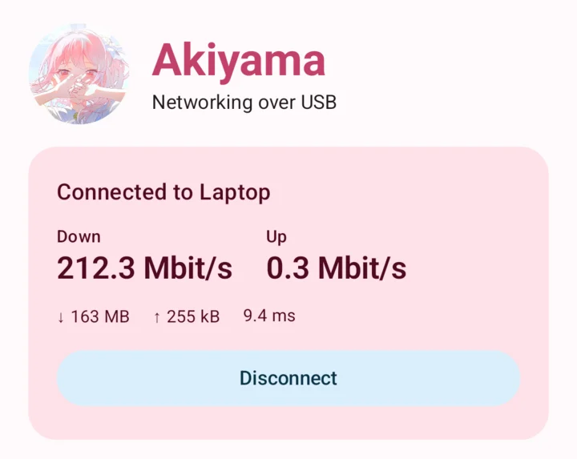

<p align="center">
  
</p>

<h1 align="center">Akiyama</h1>

<p align="center">Full-duplex networking over a USB cable.</p>

<p align="center">
  <a href="https://github.com/wonderhoy-labs/akiyama/actions/workflows/build.yml"></a>
  <a href="LICENSE"></a>
</p>

<p align="center"><sub>A <a href="https://github.com/wonderhoy-labs">Wonderhoy Labs</a> project</sub></p>

Akiyama shares a network connection between an Android phone and a computer over a USB cable. One end, the server, has the
network. The other, the client, sends all of its traffic to the server over the cable, in both directions at once, and it
goes out from there.

It's a command-line tool on macOS, Linux and Windows and an app on Android, for x86_64 and ARM. A Mac or a Linux machine can
be either end. Windows can only be the server.

Say your phone has no Wi-Fi or cellular, and your laptop has Wi-Fi. On the laptop, run this:

```bash
akiyama server
```

Then plug the phone in with a USB-C cable and allow Akiyama when it asks. Everything on the phone now goes over the cable to
the laptop and out through its Wi-Fi. There's no root on the phone, no USB debugging and no setup on the laptop's network.



> **This is early, and neither Linux nor Windows has ever been connected to a phone.** Their builds compile, but all our
> testing was one Pixel 10 Pro on Android 17 with one Mac on macOS 27. [Here's exactly what that covers.](#what-has-been-tested)
> If you try anything else, please [open an issue](https://github.com/wonderhoy-labs/akiyama/issues) and tell us how it
> went, even if it just worked.

## What you need

A USB cable that carries data, since some only charge. We've only used USB-C to USB-C. You also need:

- **Android:** Android 8 or newer, on a phone with USB accessory support, which nearly all of them have.
- **macOS:** A recent version.
- **Linux:** Permission to use USB devices. `sudo` is the simple way, and it's what the commands below would need.
- **Windows:** [Android's platform tools](https://developer.android.com/tools/releases/platform-tools) for `adb`, and
  [USB debugging](https://developer.android.com/studio/debug/dev-options) turned on. It's the only system that needs them.

Being a client on a computer needs root, because it creates a network device. Being a server on a Mac doesn't.

## Install

Download the APK and the command-line tool for your system from
[Releases](https://github.com/wonderhoy-labs/akiyama/releases).

On Android, open the APK on your phone, or install it with `adb`:

```bash
adb install -r akiyama-v0.1.0.apk
```

On macOS or Linux, unpack the tool and put it on your path. The Linux builds are static, so they run on any distribution.

```bash
tar -xzf akiyama-aarch64-apple-darwin.tar.gz
```

```bash
sudo install akiyama /usr/local/bin/
```

The builds aren't notarized, so macOS may refuse to run a downloaded one. This tells it you meant to:

```bash
xattr -d com.apple.quarantine /usr/local/bin/akiyama
```

On Windows, unpack the zip and run `akiyama.exe` from there. The builds aren't signed, so SmartScreen may complain.

You can also [build it yourself](#development).

## Use it

### Share a computer's network with a phone

```bash
akiyama server
```

Plug in the phone. The first time, Android asks whether to open Akiyama for this accessory, and then asks you to allow the
VPN. All of the phone's traffic then goes over the cable, and DNS is answered by a small resolver in the app, which asks
1.1.1.1 through the tunnel.

Android only runs one VPN at a time, so this replaces any other VPN app. Turn that one back on when you're done.

The phone's traffic follows the computer's routes, unless you name a network device or TUN for it to use instead. This works
on Linux and macOS:

```bash
akiyama server --dev xray0
```

### Share a phone's network with a computer

This works on macOS and Linux. Check that the link works first, which needs no root and changes nothing on your system:

```bash
akiyama probe
```

Then connect:

```bash
sudo akiyama client
```

The phone asks whether to share its internet, and nothing happens until you tap **Share**. There's no VPN involved on the
phone, and it doesn't need root.

The computer creates a TUN device, sends all of its traffic into it and points DNS at it. It all goes back to normal when
`akiyama` exits. To use a TUN device of your own and handle routing yourself, name it. On macOS, the name has to be `utun`
and a number.

```bash
sudo akiyama client --dev akiyama7 --no-routes --no-dns
```

Sharing stays on when the computer disconnects, so running `akiyama client` again reconnects straight away, until you tap
**Stop sharing** or unplug the cable.

### On Windows

Plug in the phone with USB debugging turned on, and run this:

```powershell
akiyama server
```

It finds `adb`, sets up a tunnel through it and opens the app. There, tap **Windows, or using USB debugging**, then **Connect
with USB debugging**. Windows has no client, so to go the other way, use USB tethering in Android's own settings.

### Switching directions

`akiyama client` can take over a phone that's already plugged in. `akiyama server` can't yet, so to go from sharing the
phone's network to using the computer's, tap **Stop sharing** and plug the cable back in.

## What has been tested

"Over USB" means a real cable between the Pixel and the Mac, in accessory mode. The development TCP link is the rest of
Akiyama with USB swapped out.

| What | Status |
| --- | --- |
| Mac as server, Android VPN as client | Works over USB, in debug and release builds, with DNS and HTTP |
| Android as server, Mac as `akiyama probe` | Works over USB, in debug and release builds, with real DNS through the phone |
| Android as server, Mac as `sudo akiyama client` | Works over USB, with IPv4, IPv6, DNS and HTTPS. Routes and DNS go back to normal on exit |
| Running `akiyama client` again with the phone still sharing | Works over USB, and reconnects at once with no second tap |
| `akiyama client` taking over a phone that's in accessory mode for something else | Works over USB. The phone resets and asks |
| A restarted server, or a restarted app, on the same cable | Works over USB. The new session replaces the old one |
| `akiyama server --adb` | Works on the Mac, with DNS through the tunnel. This is the link Windows uses |
| **Anything on Linux with a phone** | **Never run.** The tool starts on Arch, but it hasn't been connected to anything |
| **Anything on Windows** | **Never run.** It only builds |
| An Android phone with no other network | Works on an emulator with airplane mode on and Wi-Fi and mobile data off, using `--adb`. Ping, DNS and HTTP work, and Android calls the VPN validated. **Not tried on a real phone** |
| The app's screen, in light and dark | An automated test draws every state on an emulator, and we've looked at each one. Real flows ran there too, over the development TCP link |
| **Intel Macs, ARM Linux, ARM Windows, and x86_64 or 32-bit ARM Android** | **Built, never run** |
| **Android older than 17** | **Not tried.** The app's written for Android 8 and newer |
| **A sleeping phone, and battery drain** | **Not tried** |

### Speed

Measured with the Pixel on a 480 Mbit/s link, which is what its accessory mode gave us. The phone's end is where we read the
numbers when the Mac's the server.

| The Mac shares its network | Phone downloads | Phone uploads |
| --- | --- | --- |
| Download | About 210 Mbit/s | |
| Upload | | About 360 Mbit/s |
| Both at once | About 150 Mbit/s | About 130 Mbit/s |

Ping across the cable is 2 to 3 ms when idle, and about 25 ms with the link full.

| The phone shares its network | Mac downloads | Mac uploads |
| --- | --- | --- |
| Download, from a public test server | Not measured | |
| Upload, to a public test server | | About 168 Mbit/s |

That goes through the phone's Wi-Fi as well, so it says less about the cable. Ping to the phone itself is about a millisecond.

The gap between the two directions is real. A computer can only write to the phone as fast as the phone reads, and Android's
accessory driver reads 16 KiB at a time, one at a time. The phone's CPU is close to idle during a download, so it's the
waiting between reads that sets the limit.

## How it works

```
       client                                               server
                                                      the internet, or xray0
  apps and the system                                           ▲
          │                                              ordinary sockets
          ▼                                                     ▲
  TUN device or Android VPN                                     │
          │                                         userspace TCP/IP stack
          ▼                                                     ▲
   small DNS resolver                                           │
          │                                                     │
          └───────────── IP packets over USB ───────────────────┘
```

**The link** is Android Open Accessory, which any app can use without root or USB debugging. The computer stays the USB host
and asks the phone to switch modes, telling it whether the computer wants to share or be shared with. The phone comes back
as a different device with two bulk endpoints, which make a plain byte stream in both directions. Everything on it is a small
frame around an IP packet. [`docs/protocol.md`](docs/protocol.md) has the details.

Windows gets the same stream through `adb reverse` instead. The USB library we use can't send the control requests that
switch a phone's mode on Windows.

**The server** needs no root, IP forwarding or firewall rules. It gets its own userspace TCP/IP stack, based on
[smoltcp](https://github.com/smoltcp-rs/smoltcp), and every connection the client makes ends there and starts again on a
normal socket. That's how `--dev` works too: those sockets get tied to the device, so they ignore the routing table. A TCP
connection only gets answered once the real one is up, so that a client finds out when a destination can't be reached.

**The client** puts its traffic in a TUN device, or a VPN on Android, where Akiyama reads it. DNS gets special treatment. The
system is told to use a resolver at 10.233.78.1, an address that exists only inside the tunnel. Akiyama picks those queries
out, answers from a small cache if it can, and otherwise sends them through the tunnel to 1.1.1.1.

**The tunnel's MTU is 16000.** TCP connections end at the server, so nothing past it ever sees that number, and big packets
mean far less work per byte on both ends.

**The Android app** is Kotlin, including its USB and its half of the protocol. Sharing the phone's network needs that same
TCP/IP stack, so that part is the Rust code the command-line tool uses, built into the APK with the NDK.

## Security

Worth reading before you run a server.

**A phone that's plugged in can use the server's network connection.** That includes its local network and anything listening
on its own network addresses, unless you run `akiyama server --no-lan` or switch on **Keep the computer off my local network**. Clients
can't reach the server's own loopback addresses, whatever you set. `akiyama server` serves any phone that plugs in and runs
the app, unless you name one with `--serial`.

**A computer can't take a phone's network without asking.** The phone only shares after a tap, and it shows you the name the
computer gave. That name comes from the computer, so it proves nothing.

**USB debugging is less private than the normal link.** `akiyama server --adb` carries traffic through a named socket on the
phone, and another app on the phone could listen on that name first. That's why the app only connects this way when you tap
the button, and why nothing but Windows uses it by default.

**Akiyama adds no encryption.** It's a cable between two devices you can see, and it's no more private than that. Past the
server, your traffic is as exposed as on any other connection through that server, and the server's owner can see what isn't
encrypted anyway.

**When the link drops, a client's traffic stays put.** The tunnel stays up so that nothing escapes over another network.
Connections that were open are lost, and apps make new ones once Akiyama reconnects.

The hidden `--dev-tcp` option replaces USB with plain TCP, for development. Anyone who can connect gets in. Release builds of
the app don't include it, but the command-line tool does.

## Options

### `akiyama server`

| Option | Default | What it does |
| --- | --- | --- |
| `--dev DEVICE` | Follow the routing table | Network device or TUN for the phone's traffic, on Linux and macOS |
| `--dns IPV4` | `1.1.1.1` | The resolver the phone uses |
| `--no-lan` | off | Keep the phone off private addresses |
| `--adb` | Only on Windows | Connect through `adb` instead of as a USB accessory. Needs USB debugging |
| `--serial SERIAL` | Any phone | Only serve the phone with this serial number |
| `--mtu BYTES` | `16000` | The tunnel's MTU, from 1280 to 65000 |

### `akiyama client`

macOS and Linux only.

| Option | Default | What it does |
| --- | --- | --- |
| `--dev DEVICE` | `akiyama0` on Linux, the next `utun` on macOS | TUN device to use, or to create |
| `--no-routes` | off | Don't send this machine's traffic into the tunnel |
| `--no-dns` | off | Don't point this machine's DNS at the tunnel |
| `--serial SERIAL` | Any phone | Only connect to the phone with this serial number |
| `--once` | off | Exit when the link drops instead of reconnecting |

### Other commands

| Command | What it does |
| --- | --- |
| `akiyama devices` | Lists the phones it can see |
| `akiyama probe [--serial SERIAL] [--count N]` | Connects, pings the phone and does a DNS lookup through it, without changing anything. macOS and Linux only |

Add `-v` to any of them to log more, or `-vv` for even more.

## Troubleshooting

**Nothing happens when you plug in the phone.** Try `akiyama devices`. If the phone isn't listed, the cable may only charge,
or the phone may have become the USB host. With USB-C to USB-C, either end can. Open USB preferences on the phone and set
**USB controlled by** to the connected device.

**The phone's waiting, and so is `akiyama server`.** The phone's sharing its own network. Tap **Stop sharing** and plug the
cable back in.

**`akiyama` can't open the phone on Linux.** It needs permission to use the USB device, so use `sudo`.

**`akiyama client` says `couldn't open the TUN device`.** It needs root, so use `sudo`.

**`can't use network device`.** Check the name with `ip link` or `ifconfig`.

**`adb` isn't found on Windows.** Add the platform tools to your path, and allow the computer on the phone if it asks.

**DNS stays broken on a Mac after `akiyama client` was force-killed.** It normally restores this when it exits, but it can't
after `kill -9`. This puts it back:

```bash
printf 'remove State:/Network/Service/akiyama/DNS\n' | sudo scutil
```

**A computer can't reach the local network through the phone.** Android 17 needs the local network permission for this. Allow
it for Akiyama in the app's settings.

## Known issues

- Nothing has been run with a phone on Linux or Windows yet.
- `akiyama server` can't take over a phone that's sharing its own network, so [plug the cable back in](#switching-directions).
- Windows can't be a client, and it needs USB debugging.
- Downloads to the phone are slower than uploads from it, because of [how Android reads from USB](#speed).
- Pinging through a server needs a system that allows unprivileged ICMP sockets. If it doesn't, pings just go unanswered.
- There's no way yet to change the DNS resolver from the Android app when it's the server, so it always uses 1.1.1.1.

## Development

You need Rust 1.91 or newer. For the Android app you also need JDK 17 or newer, the Android SDK with platform 37, NDK
30.0.16248370 and [cargo-ndk](https://github.com/bbqsrc/cargo-ndk).

```bash
cargo test --workspace
```

```bash
cargo build --release -p akiyama
```

```bash
cd android && ./gradlew :app:testDebugUnitTest :app:assembleRelease
```

With an emulator running, this draws every state of the app's screen and checks what it says and what its buttons do:

```bash
cd android && ./gradlew :app:connectedDebugAndroidTest
```

Adding `-Pakiyama.abis=arm64-v8a` builds the app faster, for one kind of device. The APK ends up at
`android/app/build/outputs/apk/release/app-release.apk`. It's signed with your debug key unless you set `AKIYAMA_KEYSTORE`,
`AKIYAMA_KEYSTORE_PASSWORD`, `AKIYAMA_KEY_ALIAS` and `AKIYAMA_KEY_PASSWORD`.

| Where | What's in it |
| --- | --- |
| `crates/akiyama-core/` | The protocol, the NAT, the DNS resolver and the session logic, shared by everything |
| `crates/akiyama/src/aoa.rs` | Switching a phone to accessory mode, and its USB link |
| `crates/akiyama/src/adb.rs` | The `adb` link, for Windows |
| `crates/akiyama/src/tunnel.rs` | The client's TUN device, routes and DNS settings |
| `crates/akiyama-jni/` | Lets the Android app use the NAT |
| `android/app/src/main/kotlin/com/wonderhoylabs/akiyama/` | The Android app |
| `docs/protocol.md` | The wire protocol |

The protocol exists in both Rust and Kotlin. Their tests check the same bytes, so change them together.

Pushing a tag like `v0.1.0` builds everything and publishes a GitHub release. See
[build.yml](.github/workflows/build.yml) for the signing secrets it can use. Without them, each release gets a throwaway
key and has to be installed fresh instead of updating.

<details>
<summary>Testing without a cable</summary>

An emulator has no USB accessory, but for everything above USB, both ends can use TCP instead. These need a debug build. On
Android 17, an emulator also needs the local network permission to reach the computer:

```bash
adb shell pm grant com.wonderhoylabs.akiyama android.permission.ACCESS_LOCAL_NETWORK
```

To test the phone's VPN, start a server and connect the app to it:

```bash
akiyama -v server --dev-tcp 127.0.0.1:47474
```

```bash
adb shell am start -n com.wonderhoylabs.akiyama/.ui.MainActivity --es dev_tcp 10.0.2.2:47474
```

To test sharing the phone's network, have the app listen, forward a port to it, and probe it:

```bash
adb shell am start -n com.wonderhoylabs.akiyama/.ui.MainActivity --ei dev_tcp_listen 47475
```

```bash
adb forward tcp:47475 tcp:47475
```

```bash
akiyama probe --dev-tcp 127.0.0.1:47475
```

</details>

## Under the hood

None of this is needed to use Akiyama. It's here so nobody has to work it out twice.

<details>
<summary>Things we learned the hard way</summary>

- **Android's accessory driver has one 16 KiB read outstanding at a time.** An app has to offer at least that much on each
  read, and a read only finishes on a short packet. So a computer has to end every burst with one, sending an empty packet
  if the burst was an exact number of packets long. Otherwise the phone just waits.
- **A blocked read on an accessory can't be interrupted.** Closing the file doesn't do it, and opening the accessory again
  fails with `EBUSY` until that read returns. So a read can outlive the app's session, and a client sends a bye before
  saying hello, which frees one if it's there.
- **The link outlives both programs.** A new program can find the last one's unread data waiting for it, so both ends scan
  for the start of a session instead of trusting the first bytes. Each session has a random ID as well, so that a restarted
  program's hello can't be mistaken for a repeat of the last one's.
- **A blocked write stops a timeout that's waiting on the same loop.** With the app gone, nothing reads, so the writes never
  finish. The check for a silent peer has to run on its own.
- **The phone's serial string can carry a message.** An accessory's strings are the only thing a computer can say before the
  app is running, and that's how the app tells which direction you asked for. Apps can only read it once they have permission.
- **A Pixel keeps `adb` alive in accessory mode,** as product `2d01`, so you can still watch logs with the cable in.
- **Android 17 blocks private addresses without `ACCESS_LOCAL_NETWORK`,** and the connection just times out. It's easy to
  mistake for a network problem.
- **`VpnService.protect` needs a real socket.** A new Java `Socket` doesn't have one until it's bound. Without that, the
  call has nothing to act on, and a tunnel's own connection loops back into the tunnel once the VPN is up.
- **With no other network, Android can treat a VPN as offline,** unless it names itself as its own underlying network. The
  trick comes from [gnirehtet](https://github.com/Genymobile/gnirehtet). We've kept it, but we haven't tried it without
  Wi-Fi.
- **`Thread.onSpinWait` only exists from Android 13.** The compiler is happy with it on any version, and only lint says it'll
  crash an older phone.

</details>

## License and credits

Akiyama is a [Wonderhoy Labs](https://github.com/wonderhoy-labs) project, released under the
[Apache License 2.0](LICENSE). It isn't affiliated with Google or the USB Implementers Forum. Android is a trademark of Google
LLC, and USB-C is a trademark of the USB Implementers Forum.

It stands on the work of these projects, each under its own permissive license:

- [smoltcp](https://github.com/smoltcp-rs/smoltcp) (0BSD) and
  [netstack-smoltcp](https://github.com/automesh-network/netstack-smoltcp) (MIT or Apache 2.0), the userspace TCP/IP stack
- [nusb](https://github.com/kevinmehall/nusb) (Apache 2.0 or MIT), for USB on computers
- [rust-tun](https://github.com/meh/rust-tun) (WTFPL), for TUN devices
- [Tokio](https://github.com/tokio-rs/tokio) (MIT), for everything asynchronous in Rust
- [Jetpack Compose and AndroidX](https://developer.android.com/jetpack) (Apache 2.0), for the Android app
